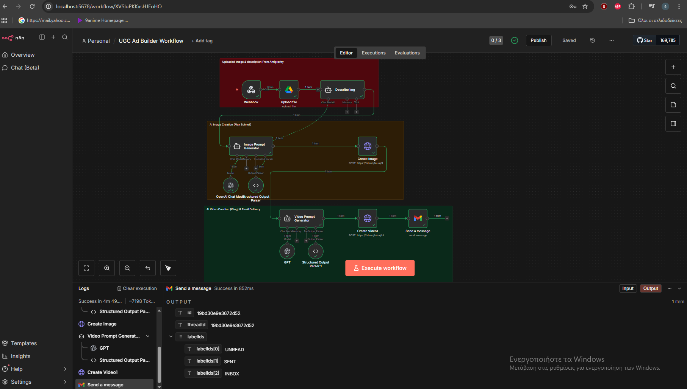

<h1 align="center">UGC Ad Builder</h1>

<p align="center">
  <strong>One product photo and a short brief in. A UGC-style video ad out, with your real product in every frame and the cost of every step known.</strong>
</p>

<p align="center">
  <a href="https://github.com/Aimilios94/UGC-Creator/actions/workflows/ci.yml"></a>
  
  
  
  
</p>

> **Status: v2 in progress (milestone M1 of 6).** The first pipeline leg works end to end locally: brief → storyboard you approve → a reference image of your product → a 5-second video clip. Full ads with voiceover, captions and music arrive in M2; measured quality and the public demo in M4. The plan is in [docs/plan/ugc-v2-full-plan.md](docs/plan/ugc-v2-full-plan.md).

## What it does

1. **Brief.** Upload a product photo; say what it is, who it is for, and any offer.
2. **Storyboard.** A vision LLM reads the photo and writes a 3-scene plan (hook, demo, call to action) with three hook ideas tagged by formula. You edit and approve it. Nothing paid renders before that.
3. **Generate.** For each scene, the real photo is edited into a new setting (image editing, so the product stays the same), then animated into a clip (image-to-video). Progress and cost show live, in euros.

## How it is built

| Part | Choice |
| --- | --- |
| API and worker | FastAPI + a worker in one Docker image: a Cloud Run service and a Cloud Run Job (europe-west4) |
| AI | Pydantic AI with structured outputs; OpenAI by default, switchable; a mock provider for tests |
| Image and video | fal: Nano Banana edit (0.0398 USD/image), Kling 2.5 Turbo Pro image-to-video (0.07 USD/s) |
| Queue and data | Postgres on Neon (Frankfurt) with pgvector; the `jobs` table is the queue (`SKIP LOCKED`) |
| Files | Private Google Cloud Storage bucket, signed expiring URLs |
| Frontend | React + Vite on Vercel |

Engineering points, each pinned by a test:

- **Spend can't run away.** Every paid stage reserves its estimate against a per-ad cap and a daily limit before it starts, under a database lock; a model with no price cannot be called. [D8, D9](DECISIONS.md)
- **Nothing is paid twice.** The provider's prediction ID is saved on submit, so a crashed job resumes by polling the same render; finished stages are skipped; a media cache serves repeats for free.
- **One approval, one job.** Approve is a single conditional update; double-clicks change nothing.
- **Private by default.** Jobs open only in the browser that made them; files are served through expiring signed URLs; uploads lose their EXIF/GPS data; fal is told not to store requests and to delete its copies after an hour.
- **CI can't spend money.** Tests force mock providers, blank every key and block outside network.

All the decisions and their reasons: [DECISIONS.md](DECISIONS.md).

## Run it

```bash
docker compose up --build      # http://localhost:5173 — mock providers, no keys, nothing paid
```

Tests, settings, Neon and the Cloud Run deploy: [docs/SETUP.md](docs/SETUP.md).

API docs are served at `/docs`. Example:

```bash
curl -X POST http://localhost:8000/jobs \
  -H "X-Session-Id: $(python -c 'import secrets; print(secrets.token_urlsafe(24))')" \
  -F 'brief={"product_name":"Grip Socks Pro","description":"Anti-slip football grip socks.","platform":"tiktok","aspect_ratio":"9:16"}' \
  -F photo=@product.jpg
```

## From v1 to v2

v1 (January 2026) was a React page posting to an n8n workflow (GPT-4o → Flux Schnell → Kling → Gmail) through an ngrok tunnel on a laptop. An audit found it never worked end to end: the form's email field was never read, the page posted to n8n's test-only webhook, and the text-to-image step meant the real product never appeared in the ad. Its notes and landing page named NanoBanana and Veo 3.1 while the nodes used Flux and Kling, and an API key sat in the public workflow file (now revoked and purged from this repo's history).

v2 rebuilds it as an engineered system. The sanitised v1 workflow is kept in [legacy/n8n/](legacy/n8n/).

<p align="center">
  
</p>

## Documents

[APP_OVERVIEW.md](APP_OVERVIEW.md) · [problem-statement.md](problem-statement.md) · [DECISIONS.md](DECISIONS.md) · [CHANGELOG.md](CHANGELOG.md) · [roadmap.md](roadmap.md) · [docs/PRIVACY.md](docs/PRIVACY.md) · [docs/notes/](docs/notes/)

## License

MIT — see [LICENSE](LICENSE).
