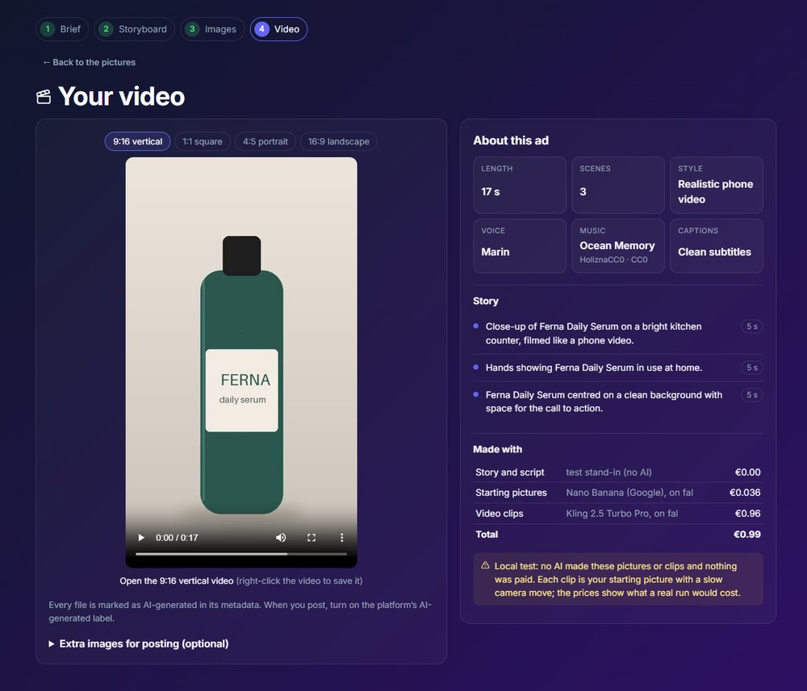
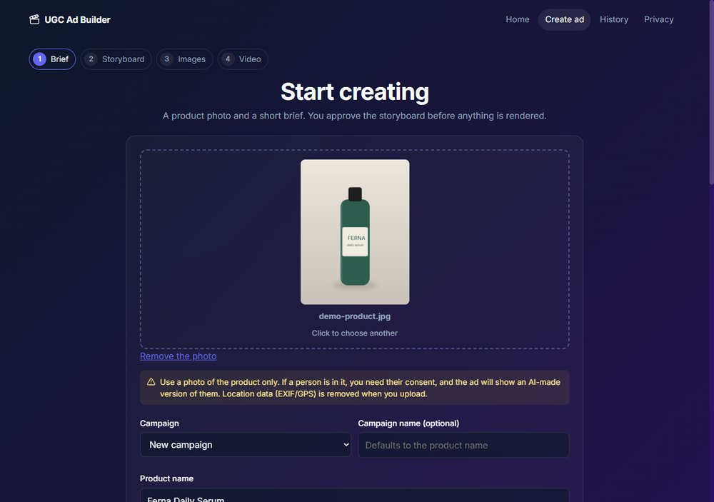
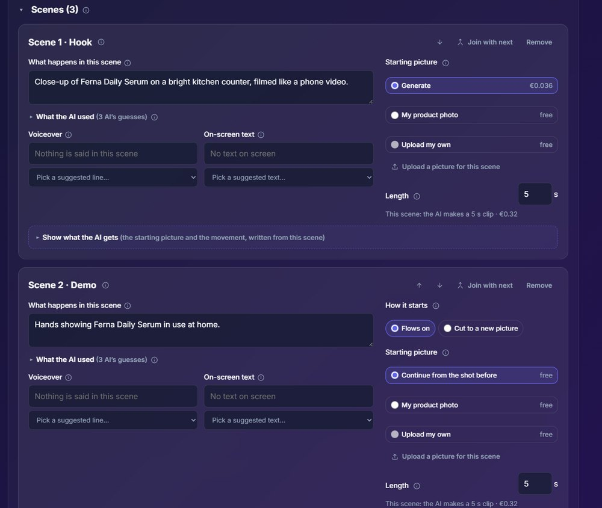

<h1 align="center">UGC Ad Builder</h1>

<p align="center">
  <strong>A product photo and a short brief in. A ready-to-post UGC-style video ad out, with your real product in every frame and the cost of every step known before you pay it.</strong>
</p>

<p align="center">
  <a href="https://github.com/Aimilios94/UGC-Creator/actions/workflows/ci.yml"></a>
  
  
  
  
  
</p>

> **Try it:** [v2, live](https://ugc-creator-delta.vercel.app) (making an ad needs an access code during early access) · [v1, the original n8n prototype (frozen)](https://ugc-creator-4a20yqpyc-aimilios-projects-21450502.vercel.app)

<p align="center">
  
</p>

## Status

| Milestone | State |
| --- | --- |
| **M1** — brief → storyboard you approve → a picture of your product → a 5 s clip (about 0.34 EUR) | Live |
| **M2** — full ads | Built on the `v2` branch, tested on mock AI and in real-AI runs; not deployed yet |
| M3 – M6 — Post Kit, measured quality and the public demo (M4), then v2.1 | Planned |

What M2 adds:

- **Ads of 1 to 5 scenes** that follow your own story and length. Timestamps, scene headings, lists and paragraphs are all read into scenes.
- **Up to 3 quick questions** when the brief is vague. Every gap the AI fills is marked "AI's guess", and you can edit it.
- **Your words reach the video AI word for word.**
- **One connected video**, where each scene flows into the next, or separate shots.
- **Your own pictures, or new ones** made from your product photo.
- **An AI voiceover, licensed music, captions and an end card**, in every platform shape, with "AI-generated" metadata on each file.
- **Themes** (beauty, fashion, food, sport, tech), a brand kit and campaigns.
- **The model and cost of every step** on the result page, and a History page of your ads.
- **Error reports** with personal data removed, a scheduled cleanup after 30 days, and a "Delete my data" button.

The full plan: [docs/plan/ugc-v2-full-plan.md](docs/plan/ugc-v2-full-plan.md).

## How it works

1. **Brief.** Add a product photo (optional) and say what it is and who it is for. You can also paste your own story or script.
2. **Storyboard.** A vision LLM reads the photo and writes the scenes. You edit everything: the text, the length, the starting picture of each scene, the voiceover and on-screen text, how the scenes connect, and the first line. Nothing paid is made before you approve, and the price is shown first.
3. **Pictures, then video.** Your real photo is edited into each scene's setting, so the product stays the same, then animated. Voice, music, captions and the end card are added, and every shape is cut.

<p align="center">
  
  
</p>

<sub>Screenshots from the local stack on mock AI: the product is a made-up drawing, and no AI or money was used.</sub>

## How it is built

| Part | Choice |
| --- | --- |
| API and worker | FastAPI and a worker in one Docker image: a Cloud Run service and a Cloud Run Job (europe-west4) |
| AI | Pydantic AI with structured outputs; OpenAI by default, switchable; a mock provider for tests |
| Image and video | fal: Nano Banana edit (0.0398 USD per image), Kling 2.5 Turbo Pro image-to-video (0.07 USD per second) |
| Voice and edit | OpenAI `gpt-4o-mini-tts`; ffmpeg and Pillow add captions, CC0 music, the end card and every shape |
| Queue and data | Postgres on Neon (Frankfurt) with pgvector; the `jobs` table is the queue (`SKIP LOCKED`) |
| Files | A private Google Cloud Storage bucket, with signed links that expire |
| Frontend | React 19 and Vite on Vercel |
| Operations | Sentry, with personal data removed before sending; a GitHub Actions schedule for cleanup |

Engineering points, each covered by tests (384 on `v2`):

- **Spend can't run away.** Every paid step books its estimate against a per-ad cap and a daily limit before it starts, under a database lock. A model with no price can't be called. [D8, D9](DECISIONS.md)
- **Nothing is paid twice.** The provider's prediction ID is saved when the job is sent. If the worker crashes, the job picks up the same render instead of paying again. Finished steps are skipped, and a media cache serves repeats for free.
- **Crashed jobs recover on their own.** A scheduled sweep puts a job stuck mid-run back in the queue, or fails it after its last try and settles its booked cost. [D34](DECISIONS.md)
- **One approval, one job.** Approval is a single conditional update, so a double-click changes nothing.
- **Private by default.**
  - A job opens only in the browser that made it.
  - Uploads lose their location data.
  - Files are deleted 30 days after an ad's last change, or at once with "Delete my data".
  - fal is told not to keep requests.
  - Error reports leave out names, IPs, request bodies and secrets.
  - Details: [docs/PRIVACY.md](docs/PRIVACY.md).
- **CI can't spend money.** Tests force mock providers, blank every key and block outside network.

Every decision and its reason: [DECISIONS.md](DECISIONS.md).

## Run it

```bash
docker compose up --build      # http://localhost:5173 — mock AI, no keys, nothing paid
```

Tests, settings and the deploy steps are in [docs/SETUP.md](docs/SETUP.md). The API docs are at `http://localhost:8000/docs`.

To make an ad from the command line, run the three calls below. There are no accounts: a random session ID sent with every request is what owns the job. The live site also needs an `X-Access-Code` header.

```bash
API=http://localhost:8000
SID=$(python -c 'import secrets; print(secrets.token_urlsafe(24))')

# 1. The brief and photo in, the storyboard out (free on mock; a few cents with real AI)
JOB=$(curl -s -X POST $API/jobs -H "X-Session-Id: $SID" \
  -F 'brief={"product_name":"Ferna Daily Serum","description":"A light plant-based serum that sinks in fast.","platform":"tiktok","aspect_ratio":"9:16"}' \
  -F photo=@product.jpg | jq -r .id)

# 2. Approve it: the pictures and the video are made in one go
curl -s -X POST $API/jobs/$JOB/approve -H "X-Session-Id: $SID" \
  -H 'Content-Type: application/json' -d '{"mode":"video"}' | jq .status

# 3. Poll until it is done, then get the signed links to the finished ads
curl -s $API/jobs/$JOB -H "X-Session-Id: $SID" | jq '{status, assets: [.assets[] | select(.kind=="ad") | .url]}'
```

If the brief is too vague, step 1 returns `questions`. Answer them with `POST /jobs/{id}/answers` before you approve.

## From v1 to v2

v1 (January 2026) was a React page posting to an n8n workflow (GPT-4o → Flux Schnell → Kling → Gmail) through an ngrok tunnel on a laptop. An audit found it never worked end to end:

- the form's email field was never read;
- the page posted to n8n's test-only webhook;
- text-to-image meant the real product never appeared in the ad.

Its notes also named models the workflow did not use, and an API key sat in the public workflow file. That key is now revoked and purged from this repo's history.

v2 rebuilds it as an engineered system. The cleaned-up v1 workflow is in [legacy/n8n/](legacy/n8n/), the v1 code is tagged [`v1-final`](https://github.com/Aimilios94/UGC-Creator/releases/tag/v1-final), and screenshots of v1 with its known issues are in [docs/before-after/v1/](docs/before-after/v1/).

## Documents

[APP_OVERVIEW.md](APP_OVERVIEW.md) · [problem-statement.md](problem-statement.md) · [DECISIONS.md](DECISIONS.md) · [CHANGELOG.md](CHANGELOG.md) · [roadmap.md](roadmap.md) · [docs/SETUP.md](docs/SETUP.md) · [docs/PRIVACY.md](docs/PRIVACY.md) · [docs/notes/](docs/notes/)

## License

MIT — see [LICENSE](LICENSE).
