# UGC Ad Builder v2 — full plan

Nov 18, 2026 · @Aimilios

This is the complete plan: the original rebuild plan with every change agreed in the reviews of 17 and 18 Nov 2026 written in. It is the single source of truth. Build work starts only when the user says so.

**Amendments (owner's decisions, recorded in `DECISIONS.md`):** D27–D30 replace the fixed 3 scenes and the one-step approval. **D31 (21 Nov 2026)** adds `docs/plan/prompt-to-ad-strategy-plan.md`, which turns any prompt into one fixed structure and is built in 6 phases before the rest of M2. Where it differs from this plan, it wins: the product photo becomes optional (without one, pictures come from the written product description, and the picture check in §8 step 4 compares against that description instead of the photo); quality comes first, so the per-ad cap (§12, §16) is a 5 EUR safety limit and the daily limit 10 EUR, at 0.91 EUR per USD; the project budget is 50 EUR; and every local test ad is kept in a local findings archive, so a later final-result judge and model comparisons build on real results.

## 1. Context

The project is a Jan 2026 prototype: a React/Vite landing page plus an n8n workflow (GPT-4o → Flux Schnell → Kling → Gmail) exposed through ngrok. The audit shows the idea is sound, but v1 does not work end to end, depends on a laptop running n8n and ngrok, and has no tests, database or quality checks. v2 rebuilds it as an engineered system: a Python LLM pipeline from code to deployment and scheduling, image and video processing in Python, SQL storage, measured evaluation of AI outputs, Docker, CI and cloud hosting.

Goal: a working, honest, engineered product in the same GitHub repo (`Aimilios94/UGC-Creator`), with the n8n version kept as v1 under `legacy/`.

What v2 is: a studio that turns one product photo and a short brief into a finished, ready-to-post video ad with everything a marketer needs to publish it, then measures how the ad performs.

**MVP = end of M4**: a deployed studio that turns one product photo and a short brief into a finished, ready-to-post video ad, with measured quality and known cost per ad. M5 and M6 are **v2.1**, so a slip there never leaves the project looking unfinished.

## 2. Decisions made with the user

- Same repo, new Python backend, existing React frontend upgraded.
- One pipeline: product UGC ads, with a theme selector (Sport, Beauty, Tech, Food, Fashion). The Sport theme includes a football pack, and one sample product is a football item.
- Ad features: storyboard first, story ads (3 scenes), Hook Lab, self-fixing ads, themes.
- Post Kit: platform texts with caption variants, suggested ad names, CTA link with UTM, ready-to-post checklist (including the AI-label item), quick edits and re-render, ZIP with A/B pack, optional email, tip card, static image ads and carousel.
- Marketing layer: guided flow, campaign brief, brand kit, ad policy check, Ad Report (page + PDF), model comparison gallery with presets; in v2.1: Performance page, Ad Review, EU rules page, Ask assistant, model dropdown in the sample demo.
- Evaluation harness, tests, Docker Compose, CI, cloud deploy, batch and scheduling are in scope. No Airflow: the GitHub Actions cron does the scheduling.
- Media provider: fal (image and video). Replicate is dropped. Voice stays OpenAI TTS.
- Database Neon (Postgres + pgvector) and file storage Google Cloud Storage, both in EU regions. Supabase is not used: the account is at its 2-project limit and free projects pause after a week of inactivity.
- Money is in EUR: the budget, cost caps, daily limit, demo pot and every price shown in the app. A USD display option sits under Advanced settings. Providers bill in USD, so costs are recorded in USD as billed and converted with one app-wide fixed rate (about 0.87 EUR per USD at planning time).
- The app is simple by default: each page shows its main actions, and the rest sits behind an **Advanced** button.
- 3D visuals (Three.js through React Three Fiber) are used only on Home and showcase sections (hero, sample ads gallery, model comparison). Work pages (Brief, Storyboard, Generate, Review, Launch kit, Performance, Ad Review) stay standard, fast React pages. When the 3D work happens is decided later; the frontend is built from M1 so it can be added without redoing the work pages.
- Layout, documents, eval and CI patterns are adapted from the user's `Aimilios94/Receipt-Ghostbuster`, cloned read-only outside this repo.
- No sign-in. Jobs are private to the browser session that created them.
- Public demo: from M1 to M4 new generation is access-code only. From M4: ready-made ads for everyone, and new generation open to visitors under a small limit paid from a fixed demo pot; when the pot is spent, generation switches back to access-code only.
- Budget: about 26 EUR for APIs (about 30 USD; see §16).
- Pace: six weekly milestones plus one spare week (week 7) as buffer. The MVP is complete at M4; weeks 5–6 are v2.1.
- Time: the user gives 15–20 hours a week, sometimes more; the milestones are sized for that.
- Work starts only when the user says so.
- Future list (not in v2): paste a shop link, virtual creators, many languages, direct posting to TikTok/Instagram, match-data graphics, content calendar, loop-friendly cut, seasonal overlays, competitor-transcript hook generation, native model audio.
- Moved to `roadmap.md` as later extras: product photo studio, talking presenter, shareable permalink, before/after slider, weekly summary PDF, Google and YouTube CSV presets, signed content credentials (C2PA), post scheduling and publishing, competitor ad tracker, social content calendar, comment and review sentiment, budget reallocation suggestions, live ad-platform APIs, email and subject line writer, Digital Fairness Act follow-up.
- Future “Insights” section (recorded in `roadmap.md`): performance aggregates by hook formula, theme and platform; creative-fatigue alerts; “your CTR vs typical for this theme” benchmarks; a cross-user hook library (needs user consent). Possible paid ladder: usage tiers, higher-quality presets, batch volume, longer retention/history, API access, direct posting.
- Future idea (v3, not planned): **Design Lab**, a conversational re-creation studio. Chat with ads already made (“change the hook”, “make it more cinematic”), choose the model per re-creation from the model matrix, see the real cost estimate before confirming, attach reference images, and pick canvas ratio and resolution. Placeholder only: no design, tasks or milestones. Add it to `roadmap.md` under the future/out-of-scope section (or a small “## Future ideas” heading) whenever that file is next touched for normal work, with no dedicated commit.

## 3. Audit findings (what v2 must fix)

- Fal.ai key hardcoded twice in `UGC Ad Builder Workflow.json` (lines 135, 223), public since commit `00d0a2e`. Personal Gmail hardcoded as recipient (line 253).
- The form's email field is dead: the workflow never reads `body.email` and the Gmail node's `sendTo` is hardcoded, so delivery to the user never worked, even locally.
- `frontend/src/components/BuilderForm.jsx:81` posts to hardcoded `http://localhost:5678/webhook-test/ugc-ad-trigger`; `VITE_N8N_WEBHOOK_URL` is never read. `/webhook-test/` only listens while the n8n editor is open; the production path is `/webhook/ugc-ad-trigger`.
- The product image is only described in text; Flux Schnell is text-to-image, so the real product never appears in the ad.
- Workflow bugs: `image_prompt` vs `prompt` schema mismatch; Video Prompt Generator has no system message; ratio/platform never sent to Fal; synchronous call for Kling; trailing newline in the Kling URL.
- The workflow sticky notes mention NanoBanana and Veo3.1 while the nodes use Flux and Kling, and `Hero.jsx` repeats that claim (“Gemini 3.0, NanoBanana, Veo3.1”). Used as the honest v1 → v2 narrative in README and CHANGELOG.
- `Hero.jsx` has invented stats; `Samples.jsx` has invented views/CTR. Hero buttons have no handlers. Page title is “frontend”. No file validation. `index.css`, `App.css` and the `framer-motion` import in `App.jsx` are unused.
- README, CLAUDE.md and context.md disagree with the code.
- No tests, CI, database, job status or result page.
- `.agent/skills/` holds two generic copied skills (`n8n-creator`, and `brand-guidelines`, which is Anthropic's own brand guide). Neither belongs to this project; both are removed.

When porting the v1 prompts to Pydantic schemas, port the intent, not the text verbatim.

## 4. Step 0 — security (user action first)

1. Revoke the leaked Fal key in the Fal dashboard. Create a new fal key, kept only in env or secrets.
2. Sanitise the workflow JSON when it moves to `legacy/n8n/` (credential placeholders, no email address).
3. Purge the key and the Gmail address from git history once, before v2 work begins (`git filter-repo` or BFG, then a force push). Agreed with the user; run only on their explicit go-ahead at that moment. `git grep` checks only the working tree, so history is verified separately. Revoking the key is the real fix; the purge is clean-up, because forks and cached commits can keep old history.
4. Local-machine cleanups, not repo changes (`frontend/.env` is gitignored and was never committed): move backend secrets from `frontend/.env` to `backend/.env`; delete the empty root `.env/` folder. In the repo: add `backend/.env.example` and `frontend/.env.example`.

## 5. Tool decisions

| Job | Choice |
| --- | --- |
| Image and video models | fal as the only media provider; mock for tests. Replicate dropped |
| Starting image model | Nano Banana family (accepts the product photo as reference), on fal |
| Starting video model | Kling image-to-video, on fal |
| Text AI | Switchable OpenAI / Claude (`llm_provider`); default chosen from eval results |
| AI library | Pydantic AI: structured outputs, tool calling (Ask assistant), self-fix loop, provider switching; its test model backs the `mock` provider |
| Voice | OpenAI TTS |
| Database + vectors | Postgres with pgvector: Docker Postgres locally and in CI, Neon hosted (free plan, EU region) |
| File storage | Local folder in dev, private Google Cloud Storage bucket hosted (EU region), signed expiring URLs |
| Backend hosting | Google Cloud Run: a service for the API, a Cloud Run Job for the worker |
| Frontend hosting | Vercel (existing project) |
| Email | Resend |
| Scheduling | GitHub Actions cron calling token-protected endpoints. No Airflow |
| Music | Royalty-free library whose licence explicitly permits paid advertising use; the check and licence text are recorded in `docs/` |
| Error monitoring | Sentry (backend + frontend), on when `SENTRY_DSN` is set, with a body/header scrubber |
| AI tracing, golden datasets, experiments | LangSmith, on when `LANGSMITH_TRACING=true` |

Notes:

- Model choice is not blocking. All media calls go through one `MediaProvider` interface, and a model is a config value. The starting models are used from M1; the model comparison in M4 confirms or replaces them. Exact fal model IDs, prices, billing units and the “Commercial use” badge of each model are verified when M1 starts.
- Why fal: lower reported prices (for example about 0.06 EUR (0.07 USD) per second for Kling 2.5 Turbo Pro) and many models behind one key. fal bills in several units (per image, per megapixel, per second of video or audio, per video, per token or unit), so the price table handles all of them.
- Other candidates for the M4 comparison: Flux Kontext (image), Seedance (video), Veo 3.1 (1–2 “hero” renders only, first to cut).
- Media cache (`services/media_cache.py`): every generation is stored under a key of model + version, prompt, seed, input image hash and settings (ratio, duration). Evals, judge calibration, the model matrix, the comparison gallery and the sample demo reuse cached generations and never pay twice.
- Audio rule: the TTS voiceover and music bed always win. A model's native audio is removed in `compose.py`, and silent model tiers are preferred where cheaper. The judge does not assess audio; audio is covered by code checks (track present, duration, loudness).
- Pydantic AI: check current docs (context7) before building. Verify Pydantic AI → LangSmith tracing (OpenTelemetry) at build time; fallback is Logfire for traces, with LangSmith kept for datasets and experiments.
- In-repo eval scripts are the CI source of truth; LangSmith is the place to explore and compare.
- User setup steps are listed in §19.

## 6. Structure (mirrors Receipt-Ghostbuster)

```
backend/
  app/
    main.py, config.py, models.py (Pydantic), repository.py (SQL access),
    worker.py (Cloud Run Job entrypoint; same code runs as the Compose worker)
    routers/    health, themes, campaigns, brand_kit, jobs, storyboard, variants, postkit,
                report, performance, ad_review, rules, batch, admin (cleanup + sweep),
                privacy (delete my data), metrics, chat
    services/
      providers/      llm.py (openai | anthropic | mock), media.py (fal | mock),
                      storage.py (local | gcs)
      pipeline.py     stage orchestration, status + cost per stage, cost cap and daily limit checks
      uploads.py      file type/size guard, EXIF/GPS stripping
      demo.py         daily limits, demo pot reservation, access codes, sample-product replay
      media_cache.py  cached generations keyed by model, prompt, seed, image hash, settings
      analyze.py      vision LLM → ProductAnalysis
      storyboard.py   3-scene plan, voiceover lines, three hooks with formula tags, testimonial rule
      image_gen.py    reference-image generation that keeps the real product
      video_gen.py    image-to-video, async submit/poll
      judge.py        LLM judge on reference images, drift check on sampled video frames
      selffix.py      retry loop driven by the judge
      voice.py        TTS voiceover
      compose.py      ffmpeg + Pillow: stitch, captions, watermark, end card, music, ratios,
                      stills, AI-generated metadata on every export
      output_checks.py  code-graded checks on the composed ad
      themes.py, platform_specs.py, postkit.py, policy.py, report.py,
      performance.py, ad_review.py
      chat.py, chat_judge.py, retrieval.py
      eval_metrics.py, llm_trace.py (price table, every billing unit), monitoring.py
    themes/           one YAML per theme
  eval/               fixtures/, labels, baseline.json, baseline.mock.json, metrics.json,
                      RESULTS.md, MODELS.md, CALIBRATION.md, badges/, chatbot/, test/
  scripts/            eval_ads.py, eval_models.py, eval_chatbot.py, check_regression.py,
                      make_badges.py, prepare_test_set.py, langsmith_eval.py,
                      apply_schema.py, run_batch.py
  tests/
  Dockerfile, requirements.txt, .env.example
db/schema.sql
frontend/             existing app; pages/: Landing, Brief, Storyboard, Generate, Review, LaunchKit,
                      BrandKit, History, Performance, AdReview, Evals, Models, Rules, Ask, Privacy;
                      lib/api.js
legacy/n8n/           sanitised v1 workflow + screenshot
docs/                 SETUP.md, MONITORING.md, PRIVACY.md, design/, demo/, rules/, notes/, plan/
sample-data/          products CSV (including one football product), sample images, demo results
docker-compose.yml    api, worker, postgres (pgvector), frontend
.github/workflows/    ci.yml, plus cron workflows (cleanup + sweep, batch)
README.md, LICENSE, APP_OVERVIEW.md, CHANGELOG.md, DECISIONS.md, problem-statement.md,
roadmap.md, feedback-notes.md, CLAUDE.md
```

`context.md` is folded into `APP_OVERVIEW.md` and removed; `CLAUDE.md` is rewritten for v2; `.agent/skills/` is removed.

Reused from Receipt-Ghostbuster (adapt, do not rewrite; the clone lives outside this repo with pushing disabled):

- `backend/app/config.py` — pydantic-settings pattern, app imports without secrets, provider switch including `mock`.
- `backend/app/services/llm_trace.py` — `LlmCall`, `price_usd`, `aggregate`; extended with every fal billing unit.
- `backend/app/services/monitoring.py` — Sentry setup and scrubber.
- `backend/scripts/check_regression.py`, `make_badges.py`, `langsmith_eval.py`, `prepare_test_set.py`, and the `baseline.json` / `baseline.mock.json` convention.
- `backend/app/services/chat.py`, `chat_judge.py`, `backend/scripts/eval_chatbot.py`, `eval/chatbot/` layout and `CALIBRATION.md`.
- `.github/workflows/ci.yml` — frontend build + backend pytest + mock eval smoke run + regression gate; add ruff, eslint, a Postgres service container and a Docker build.
- `routers/` + DB-free `services/` + `repository.py` split; `db/schema.sql`; the document set.

## 7. The guided flow and app sections

Main flow: Brief → Storyboard → Generate → Review → Launch kit → Performance (v2.1). The current `BuilderForm.jsx` becomes step 1.

1. **Brief** — product photo (with a warning about people in photos), campaign brief (goal, audience, offer/promo code, landing URL), theme, platform, ad type, model preset, Hook Lab on or off (about 0.10 EUR upfront). Brand kit (logo, colours, fonts, tone) is set once and reused. A “Try with a sample product” button (M4) replays a pre-analysed sample product through all the steps from cached generations, so a visitor sees the full flow with no upload and no cost.
2. **Storyboard** — the user edits and approves the 3-scene plan. Nothing paid runs before approval.
3. **Generate** — live progress per stage, live cost ticker in EUR, self-fix retries visible, Hook Lab ranking.
4. **Review** — player, ready-to-post checklist, ad policy check, quick edits, “build variant B/C” buttons (cost shown first), Approve.
5. **Launch kit** — Post Kit download or email, tip card, Ad Report.
6. **Performance** (v2.1) — import results, verdict per ad, winning hook.

**App sections** (navigation; each item appears when its milestone ships):

1. **Home**: watch the sample ads, try the sample product, start an ad
2. **Create ad**: the guided steps above
3. **Brand kit**: logo, colours, fonts, tone
4. **History** (M2): your ads with cost and scores, Ad Report
5. **Performance** (v2.1): basic view plus advanced options
6. **Ad Review** (v2.1): upload any ad, get a scorecard
7. **Models** (M4): compare models, cost and quality
8. **Evals** (M4): quality results
9. **Rules** (v2.1): EU ad rules with official sources
10. **Ask** (v2.1): questions about your ads
11. **Privacy** (M1): the notice; delete my data (M2)

Simple by default: each page shows its main actions, and the rest sits behind an **Advanced** button. The Performance page uses this first; Brief, Review and Ad Review follow the same pattern where it helps. 3D visuals (Three.js through React Three Fiber) appear only on Home and showcase sections; work pages stay standard (see §2).

## 8. Ad pipeline

The judge and self-fix run on the reference image, before any video is paid for: a retry there costs about 0.04 EUR, against about 0.45 EUR for a 5-second clip. After the video, the judge only checks for drift from the approved image.

1. **Analyze**: vision LLM → `ProductAnalysis`.
2. **Storyboard**: 3 scenes (hook, demo, call to action), voiceover lines and three alternative hooks, each tagged with a formula archetype; built from the brief, theme and brand kit. Rule: no first-person claims of use, experience or results (“I've used this for 3 months”) unless the brief supplies them.
3. **Human gate**: approval in the UI. Nothing paid runs before it.
4. **Image + judge + self-fix**: one reference image per scene, scored on product fidelity vs the uploaded photo, packaging text, UGC realism, brief adherence and safety. Below threshold on fidelity or text: rewrite the prompt from the judge's reason and retry, max 2 retries, under the cost cap. Every attempt is stored.
5. **Hook Lab** (when on): three scene-1 hook images, each through step 4; the judge ranks them with reasons; the winner goes on. When off, the first hook is used.
6. **Video**: image-to-video per scene from the approved image, at the requested aspect ratio (the master ratio); async submit and poll, prediction ID saved.
7. **Drift check**: sampled video frames compared against the approved reference image. Below threshold: max 1 video retry under the cost cap, otherwise the scene is flagged in Review.
8. **Compose** (Python) for the winning hook: stitch scenes, voiceover, burned-in captions, logo watermark, end card with CTA and offer, music bed, cover image, scene stills and carousel. Compose writes “AI-generated” metadata into every exported file, because re-encoding drops any marking the provider added.
9. **Ratios**: the master is the requested ratio. Other ratios are derived by smart crop or pad (blurred fill), with captions and end card laid out again per ratio, and exported only if the safe-zone check passes.
10. **Output checks** (code-graded, post-compose): file plays, duration, resolution, ratio, audio track, captions inside safe zones, sound-off check (offer and CTA text appear in captions or end card).
11. **Post Kit and Ad Report** are built.

**Variants B and C** are on request: the user clicks “build variant B/C”, sees the cost first (about 0.45 EUR per scene-1 video), confirms, and only then is that video rendered. Composition from the stored clips costs nothing.

The judge sees raw images and frames only. Everything added in compose (captions, watermark, end card, audio, metadata) is verified by the code-graded checks in step 10.

## 9. Themes and brand kit

- Themes: `backend/app/themes/*.yaml` (sport, beauty, tech, food, fashion): default tone of voice, caption style, palette, music mood, scene ideas, end-card layout, and the hook formula taxonomy (POV, problem-first, 3 reasons, unboxing tease). Loaded by `services/themes.py`; a new theme needs no code. Replaces the old Tone dropdown; Ad Type stays.
- The Sport theme YAML includes a football scene-idea and hook pack. One football product (generic, unbranded: boots, shaker or grip socks) is in `sample-data/products.csv`, so the seeded demo ads include a football example shown in the gallery and History like any other.
- Brand kit (`brand_kits` table): logo, colours, fonts, tone as plain fields. Where set, brand kit values override the theme's defaults. No RAG.

## 10. Post Kit (`services/postkit.py`)

- Platform texts: headline, description, hashtags and 2–3 caption variants per platform (text-only cost), validated against `services/platform_specs.py`.
- Suggested ad names carrying the variant ID (for example `ugc-<job>-B`), so results imported from ad platforms match the right ad later.
- CTA: button label from the platform's allowed list; destination URL with UTM tags per variant.
- Ready-to-post checklist: the output checks from §8 step 10; per-platform items for the branded-content and AI-generated-content toggles (names verified against each platform at build time); an optional “AI-generated” caption line; a rights checkbox that includes consent of anyone shown; final Approve. The AI label is recommended for every ad, since every voiceover is synthetic.
- Quick edits: caption text, CTA, logo and end card re-rendered by `compose.py` from stored scene clips, with no new AI generation.
- ZIP: winning ad in the ratios that passed, cover image, static images and carousel, texts and suggested ad names as `.txt`/`.json`, a policy-check summary line (flags found, date, “not legal advice”); variants B and C included as full ads when the user built them.
- Hook Lab cost: about 0.10 EUR upfront (two extra images plus judging); about 0.45 EUR per B/C video, only on request.
- Optional email (Resend): sends the kit link to the address the user types. In the public demo it is rate-limited per session and sent only from the project's own domain, and a config flag switches it off entirely, so it cannot be used as a spam relay.
- Tip card: LLM-written “how to use this ad” (best platform, audience suggestion, how to A/B the hooks and captions, metric to watch, a suggested first comment, and a general posting-time starting point from a static per-platform table), all labelled as suggestions, with no invented statistics.

## 11. Marketing layer

- **Campaign brief** (`campaigns` table); ads are grouped under a campaign.
- **Ad policy check** (`services/policy.py`): LLM + rule list flags unsupported or risky claims, missing AI-content disclosure, invented testimonials and fake reviews, realistic people (“label as AI-generated”), and regulated categories (finance, alcohol). The rule list is a short machine-readable file written in M3; from M5 each flag links to the matching entry on the Rules page.
- **Ad Report** (`services/report.py`): per ad, from `stage_runs` and `llm_calls`: models, time and cost per step, retries, judge scores, user rating (3-question form, `ratings` table), optional “AI-generated” note. In-app page plus PDF.
- **Model comparison gallery**: built from the eval model matrix and the media cache; same product and prompt per model, with cost, latency and score. Presets (Budget, Balanced, Best quality) map to model sets in config.
- **Model dropdown in the sample demo** (v2.1): the visitor picks a model and sees its pre-made results side by side, replayed at no cost. The sample product is one of the M4 comparison products.
- **Landing-page messaging**: “checked for common risky claims under EU ad rules”, never “compliant” or “legally approved”.

### Performance page (v2.1, replaces the results tracker)

One page, one row per ad, simple by default. Currency is EUR (a USD display option sits under Advanced settings), using the one app-wide rate.

**Basic view**

- Import a CSV (Meta preset, TikTok preset, or the generic template)
- Five headline numbers per ad: spend, CPA, ROAS, profit, verdict
- Verdict with a one-line reason
- Winning hook
- Send the winner to the next storyboard

**Advanced options**

- Enter results by hand; map CSV columns
- Targets per campaign (ROAS, CPA), minimum sample size (default 1,000 impressions plus a minimum number of conversions), margin and break-even ROAS
- Details: CTR, CPC, CPM, hook rate, hold rate
- Total cost breakdown; judge score and policy flags per ad
- Rank (by ROAS or profit per euro), group (by theme, platform, hook formula, always with the number of ads behind each figure), filter by label
- Export

**Rules**

- No live ad-platform APIs: manual entry and CSV import only.
- Raw fields: platform, date range, spend, impressions or views, clicks, conversions, revenue (labelled platform-reported), 3-second views, ThruPlays or watch time.
- Rows match ads by the suggested ad name from the Post Kit; unmatched rows are shown for manual matching. Invalid rows get a clear error.
- Metrics: CTR = clicks / impressions; CPC = spend / clicks; CPM = spend / impressions × 1000; CPA = spend / conversions; ROAS = revenue / ad spend; hook rate = 3-second views / impressions; hold rate = ThruPlays / 3-second views (definition configurable). Every division is guarded.
- Total cost = production cost (from `llm_trace`) + ad spend. Profit = revenue × margin − ad spend − production cost. Without a margin the column shows “revenue minus costs”, not profit. Break-even ROAS = 1 / margin.
- Every row and figure carries a label: demo, organic or paid; labels are never mixed in one figure without showing the split.
- Organic mode (spend = 0): CPA, CPC, CPM and ROAS show “n/a”; rows rank by views, hook rate, hold rate and clicks, and the verdict says it uses engagement only.
- Verdicts: **Scale** (sample OK, ROAS at or above target, profit positive), **Pause** (sample OK, below break-even), **Iterate** (in between, for example good CTR but bad CPA), **Too early** (sample below minimum). An ad below the minimum sample is never shown as a winner.
- The winning hook and formula feed the next storyboard as context.
- Demo data is seeded and labelled “demo”, so the page works in the public demo.
- Tables: `ad_results` holds the raw fields and label; `campaigns` gains target ROAS, target CPA, minimum sample and margin. The USD→EUR rate is one app-wide setting, not per campaign.

### Ad Review (v2.1)

Upload any ad video and get a creative scorecard. A video file holds no KPIs, so the scorecard never shows CTR, CPA or ROAS for an ad you did not run; real numbers come only from an import on the Performance page.

- **Basic scorecard**: hook in the first 3 seconds, sound-off readiness, CTA clarity, product and brand on screen, platform fit (length, ratio, safe zones), policy flags (risky claims, AI label needed, testimonial-style claims).
- **Advanced**: pacing, on-screen text density, hook formula, voiceover and music present, comparison with your own winning ads.
- Reuses the judge, output checks and policy check: one vision call on about 10 frames plus a transcript, a few cents per review, under the cost cap and the global daily limit (`ad_reviews` table).
- The user uploads the file; the app never scrapes TikTok, Meta or YouTube. Reviews are private, other people's ads are never republished, and the normal retention and delete rules apply.
- On the public demo, Ad Review is behind the access code until the user decides otherwise.

### EU and platform rules

The rules stay light: short sourced entries, a few flags and a few checklist items, never a compliance engine.

EU rules page (v2.1): `docs/rules/*.md` rendered in-app; 11 entries, each a 2–3 line summary plus an official source link (EUR-Lex, the European Commission, a data protection authority or the platform's own policy page), the “not legal advice” label and a last-checked date. Anything that cannot be verified at an official source is left out. Entries: misleading advertising, data/targeting, AI-content labelling, paid-content disclosure, health and cosmetic claims, environmental claims, pricing and price-reduction claims, comparative advertising, advertising to minors, Dutch advertising code, platform ad policies. It is the readable version of the policy check's rule list and kept in step with it.

Four entries are extended:

- **AI-content labelling**: AI Act Article 50 applies from 2 August 2026; for generative AI systems already on the market before then, machine-readable marking applies from 2 December 2026. Covers the marking duty and the deepfake labelling duty, with the Commission's Article 50 guidelines (20 July 2026, date to be confirmed at an official source) and the Code of Practice on AI-generated content (10 June 2026). Whether this app counts as a provider for the marking duty is left to the guidelines, not decided by the entry.
- **Misleading advertising**: adds fake reviews and invented testimonials, plus one “watching” line on the Digital Fairness Act (Commission proposal of 11 November 2026; nothing applies yet).
- **Data and targeting**: adds the providers that process data, data transfers, and one line: a consent banner is needed only if non-essential cookies or analytics are added.
- **Platform ad policies**: adds each platform's AI label (verified at build time) and restricted categories.

In the product:

| Item | Where | Milestone |
| --- | --- | --- |
| Providers named in the privacy notice, with data transfers | Privacy page | M1 |
| Warning about people in uploaded photos | Upload | M1 |
| No invented testimonials in scripts | Storyboard rule | M2 |
| “AI-generated” metadata on every export | `compose.py` | M2 |
| Delete my data, per browser session | Privacy page | M2 |
| AI label item per platform, optional “AI-generated” caption line | Post Kit checklist | M3 |
| Rights checkbox includes consent of anyone shown | Post Kit checklist | M3 |
| Flags: invented testimonials and fake reviews, realistic person, regulated categories (finance, alcohol) | Policy check | M3 |
| Optional “AI-generated” note | Ad Report | M4 |
| Extended entries above | EU rules page | M5 |
| Digital Fairness Act follow-up | `roadmap.md` | M5 |

Providers that see user data: fal (photo, prompts), OpenAI and Anthropic (photo, brief), Neon and Google Cloud (stored jobs and files), Resend (email address), Sentry (scrubbed errors), LangSmith (traces), Vercel (frontend). Their regions and terms are checked in M1.

Extra effort for the rules work: about 10–12 hours: M1 +1, M2 +4, M3 +3–4, and the rules page is budgeted at 5–6 hours in M5.

### Ask assistant (v2.1)

- `services/chat.py`: tool calling over the ad database (costs, scores, results) plus RAG over the app guides and rules pages.
- RAG (`services/retrieval.py`): guides and rules chunked and embedded into pgvector (`doc_chunks` table). The retriever sits behind an interface so Pinecone could be swapped in. The RAG half is the first cut if v2.1 runs short; tool calling stays.

## 12. Data and hosting

### Data

- Postgres via `DATABASE_URL` (Neon, EU region); plain SQL in one idempotent `db/schema.sql` applied by `apply_schema.py`, plus `repository.py`. No migration tool. Each table is added to the file when its feature is built.
- Tables, by the milestone that creates them (all are used permanently afterwards): `jobs`, `scenes`, `stage_runs`, `assets`, `media_cache`, `llm_calls` (M1); `campaigns`, `brand_kits`, `variants` (M2); `evaluations`, `demo_usage` (M3); `ratings` (M4); `ad_results`, `batches` (M5; `campaigns` gains targets, minimum sample and margin); `ad_reviews`, `doc_chunks` (M6).
- `llm_calls` has a `kind` column (`llm` | `image` | `video` | `tts`) so Ad Report sums stay clean.
- Money: provider costs are recorded in USD as billed. Everything the user sets or sees (budget, cost cap, daily limit, demo pot, prices, Performance figures) is in EUR, converted at one app-wide fixed rate set in Advanced settings, where the display can also be switched to USD.

### Hosting

| Part | Decision | Why |
| --- | --- | --- |
| Frontend | React/Vite on Vercel (existing project) | Unchanged |
| API | FastAPI on a Cloud Run service, request-based billing | Scales to zero; does no background work |
| Worker | A Cloud Run Job running the same image with the worker entrypoint; task timeout set explicitly to 30–60 min; max retries 1 | Runs to completion after the response; the default 10-minute timeout is too short for a 3-scene job |
| Queue | The `jobs` table in Postgres, claimed with `FOR UPDATE SKIP LOCKED`; no Redis | One less service; the job claims work itself, so no job overrides are needed |
| Database | Neon Postgres with pgvector, free plan, EU region | Supabase is at its project limit and free projects pause after a week |
| Connections | Generous connect timeouts and retries in the API and worker | Neon scales to zero, so the first connection after idle is slower |
| File storage | Local folder in dev; private GCS bucket (EU region) in the same Google Cloud project, signed expiring URLs | Same project and permissions as Cloud Run |
| Secrets | New fal key in env / secret storage only; the leaked key is revoked first | The old key is public in git history |
| Spend limits | Per-job cost cap, demo pot, and a global daily spend limit inside the app, on top of the balance limit in the fal dashboard | One runaway loop or bug cannot drain the account |
| Local dev | Docker Compose: api, worker (same job code, run in a loop), postgres with pgvector, frontend | No Airflow profile |

Permissions: the API's service account may start the job and nothing more; it never passes overrides. The job's service account reads and writes the bucket. Exact role names are checked against the Cloud Run docs in M1. All of this is recorded in `DECISIONS.md` in M1.

### Job reliability and cost controls

A paid job runs at most twice automatically, never pays twice for a finished stage, and can never spend past its cap or the demo pot by more than estimate error. These rules are recorded in `DECISIONS.md` and each one has a guardrail test.

*(Job states diagram: see the Mermaid version below.)*

The same states as text, so exports keep them:

```mermaid
stateDiagram-v2
    [*] --> queued : Approve (one row; visitor job reserves pot)
    queued --> running : claim (SKIP LOCKED, attempts+1)
    running --> done : all stages finish
    running --> queued : crash via handler/sweep, attempts < 2
    running --> failed : handler/sweep, attempts >= 2
    queued --> failed : sweep bug-catcher, attempts >= 2
    failed --> queued : user "try again" (attempts reset, spend kept, fresh reservation)
    done --> [*] : unused reservation released
    failed --> [*] : unused reservation released
```



**Enqueue and claim**

- Approve creates exactly one job row per approved storyboard (enqueue idempotency), so a double-click or client retry cannot create two paid jobs. It then starts a Cloud Run Job execution with no overrides; a second execution just claims another queued job or finds none.
- The claim is a short, committed `UPDATE` (status `running`, `claimed_at = now()`, `attempts + 1`) on the oldest queued row picked with `SKIP LOCKED`. No transaction stays open during the job, which Neon idle connections would break.
- An execution that finds the queue empty exits with code 0, so a spurious trigger is not a failure.
- Every stage saves its provider prediction ID and status in `stage_runs` as soon as it submits. A re-attempt skips finished stages and polls a submitted render instead of resubmitting it. The media cache stacks on top.

**Failure handling**

- Exception handler (fast path): if `attempts ≥ 2`, set `failed`, store the last error on the job and show it in the UI; otherwise set `queued` again.
- Stale-job sweep (safety net, because an out-of-memory kill or a timeout can skip the handler): runs on the GitHub Actions cron through a token-protected endpoint, together with retention cleanup. A job `running` with `claimed_at` older than the task timeout plus a margin is requeued and a new execution is started if `attempts < 2`, otherwise marked `failed`. Any job `queued` or `running` with `attempts ≥ 2` is marked `failed` (a bug-catcher, not a normal path).
- Recovery time after a crash that skips the handler equals the cron interval; this is documented and accepted for the demo.
- Cloud Run Job retries are set to 1 (default is 3), so a crash loop is bounded. The attempt cap is the real backstop: a crash after a render was submitted but before its prediction ID was saved would pay again on each attempt.
- A user “try again” is a human decision: it resets `attempts` to 0 but never resets the job's spend.

**Cost cap, daily limit and demo pot**

- Estimates and recorded costs use the same price table (`llm_trace`), so estimate error is only vendor price drift; M1 verifies the prices. The table handles every fal billing unit.
- Per-job cost cap: before each paid stage, spend so far plus that stage's estimate must fit under the cap, or the stage does not start. The cap counts all spend across every try of the job. The cap value is set in EUR in config after the M1 price check.
- Global daily spend limit: no paid stage starts once the day's total app spend plus the stage's estimate would pass it.
- Every paid action follows these rules, including Hook Lab B/C renders, the real-results checks and Ad Review.
- Demo pot: a visitor job starts only if one conditional `UPDATE` on `demo_usage` reserves its estimated full cost (Hook Lab included) from the remaining pot; otherwise generation needs an access code. Before each paid stage, the stage must fit within the job's reservation and what is left in the pot.
- The reservation stays with the job while it is queued or running, including between attempts. Its unused part is released only at a terminal state (`done` or `failed`), by whichever of worker, handler or sweep sets it. “Try again” makes a fresh reservation for the estimated remaining cost through the same conditional `UPDATE`.

### Demo access and privacy

- Demo privacy: a job is reachable only with its unguessable ID, held in the creating browser; History shows that browser's own jobs plus the seeded demo ads, which are stored separately from live generations. Live uploads and outputs are deleted after a configurable retention period (default 30 days); “delete my data” removes a session's jobs and files at once (M2).
- Assets: private storage bucket, served through signed, expiring URLs, so stored ads cannot be enumerated.
- Batch, cleanup/sweep and any other administrative endpoint require a secret token (GitHub Actions secret sent as a header); without it, anyone could trigger paid jobs on the public deployment.
- Privacy of the demo itself: a privacy notice naming the providers and data transfers; the email address is stored only to send the kit and then deleted; EXIF/GPS data is stripped from uploaded photos; a warning about people in photos at upload; no analytics or trackers without consent; the Sentry scrubber covers emails and URLs inside briefs and job payloads.
- Demo access, M1–M4: new generation on the public deployment requires an access code; without one the site is read-only.
- Demo access, from M4: seeded ads and the sample-product replay are open to all. New generation is open while the demo pot (4.5 EUR, a configured spend total in `demo_usage`) lasts, under three limits that must all pass: 1 ad per browser session per day, 1 ad per IP address per day, and 2 ads per day across all visitors. The IP is stored only as a salted hash with a salt that rotates daily. When the pot is used up, generation requires an access code again. The per-job cost cap and the global daily limit apply in every mode.

## 13. Batch and scheduling

- `scripts/run_batch.py`: CSV of products (image path, brief, theme, platform) → queued jobs with auto-approved storyboards → Post Kits and a summary report (v2.1).
- Scheduled triggers: GitHub Actions cron calling token-protected endpoints: cleanup and stale-job sweep (M2), batch (v2.1). The scheduled batch uses the mock provider by default, so it never spends money unattended; a real batch is started by hand.
- No Airflow. Post scheduling and publishing to platforms is not built; it is on the roadmap (it would need each platform's API review and a small due-posts queue on the same cron).

## 14. Evaluation harness

- Storyboard and text eval (code-graded): schema valid, 3 scenes, per-platform lengths, CTA from the allowed list, offer/price equals the brief (no invented figures or claims), each hook has a formula tag, no first-person use or results claims unless the brief supplies them.
- Storyboard tone (LLM judge on text): script tone matches the brand kit tone. Brand logo and colours are applied by code and need no judge.
- Output checks (code-graded): as in §8 step 10.
- Ad quality (LLM judge, 1–5 rubric) on reference images and on sampled frames of raw scenes: product fidelity vs the uploaded photo, packaging text preserved, UGC realism, brief adherence, safety. The drift judge compares sampled video frames with the approved reference image.
- Judge calibration: about 20 cached outputs from the dev set (including failed self-fix attempts as bad examples) hand-labelled by the user, with no new paid generations; judge trusted only at ≥90% agreement and 100% recall on bad ads; `CALIBRATION.md` generated, limits stated. In-app user ratings are reported next to it as ongoing judge agreement.
- Self-fix metrics, reported per stage (image stage and drift stage separately): fix rate, false-pass rate (bad ad approved), over-retry rate (good ad retried).
- Policy check eval: labelled texts with planted risky claims, invented testimonials and regulated-category claims → recall and precision.
- Ask assistant eval (`eval/chatbot/`, v2.1): answer correctness graded in code over a committed synthetic ad database; tool selection; refusal of out-of-scope questions; faithfulness judge (invented-figure rate); retrieval hit rate.
- Model matrix (`eval_models.py` → `MODELS.md`): image models on the full dev set (about 10 products); video models on 2–3 products, one scene each; Veo limited to 1–2 hero renders. The sample product is one of the comparison products. `MODELS.md` states that the video comparison is a demonstration on a small sample, not a benchmark. Hard cap of 9 EUR on comparison spend beyond the seeded ads. A frozen held-out test set (`eval/test/`, `freeze.json`) covers the text and image stages only, where runs are cheap, and is never used for prompt tuning.
- Each eval has `baseline.json` + `baseline.mock.json`, a `RESULTS.md`, badges, and a CI step in mock mode; real numbers are gated locally on cached outputs. `GET /metrics/eval` feeds the Evals page.
- LangSmith: the committed fixtures are uploaded as golden datasets; `langsmith_eval.py` runs prompt/model experiments.

## 15. Tests

- Unit: platform specs, UTM builder, suggested ad names, theme loader and brand-kit override, safe-zone maths, crop/pad ratio logic, media cache key, cost calculation for every billing unit, EUR conversion and the USD display option, checklist rules, Performance metrics and verdicts, `check_regression.py`, badges.
- Integration: full flow through the API with mock providers (brief → storyboard → approve → Post Kit ZIP); `compose.py` on tiny fixture clips with real ffmpeg; repository against a Postgres service container in CI.
- Regression: the gates above; `test_published_numbers.py` (README figures match results).
- Guardrails: upload type/size guard, access-code gate, the three demo limits (per session, per IP, global daily), demo pot switch back to access code, per-job cost cap, job privacy (another session cannot read a job), email gating in demo mode, batch endpoint rejects calls without the token, asset URLs expire, EXIF stripped on upload, Sentry scrubber removes emails and URLs from payloads, prompt injection in the brief text, and image-borne prompt injection (packaging text such as “ignore previous instructions”).
- Frontend: lint + build on every PR; a small Playwright smoke test of the guided flow on push to main or nightly only (first item to cut).

Guardrail tests added by the reviews (28), each pinning one rule:

| Test | Milestone |
| --- | --- |
| A double-clicked or retried Approve creates exactly one job row | M1 |
| An execution started with an empty queue exits with code 0 | M1 |
| A retried job resumes from `stage_runs` and never pays again for a finished stage | M1 |
| A job that always fails ends `failed` after 2 attempts, with its error stored and shown | M1 |
| No paid stage starts once spend so far plus the stage estimate exceeds the cap | M1 |
| After a “try again”, the cap still counts spend from every earlier try | M1 |
| No paid stage starts once the global daily spend limit would be passed | M1 |
| The cost estimate is correct for every billing unit (per image, per megapixel, per second, per video, per token or unit) | M1 |
| CI runs with mock providers and makes no real provider calls | M1 |
| The API and worker connect after a simulated first-connection failure (Neon wake-up) | M1 |
| A stale `running` job is requeued by the sweep and picked up without a new approval | M2 |
| A queued job with `attempts ≥ 2` is marked `failed` by the sweep and never started again | M2 |
| The cleanup/sweep endpoint refuses calls without the token | M2 |
| Retention cleanup deletes expired uploads, outputs and stored emails | M2 |
| “Delete my data” removes the session's jobs and files, and another session's are untouched | M2 |
| Every exported file carries “AI-generated” metadata | M2 |
| A storyboard contains no first-person use or results claims unless the brief supplies them | M2 |
| The policy check flags a planted invented testimonial and a planted regulated-category claim | M3 |
| No visitor job starts when its full estimate exceeds the remaining pot | M4 |
| Two concurrent visitor jobs cannot both pass the pot check and overshoot it | M4 |
| A job that dies mid-run and ends `failed` leaves no leaked reservation; a requeued job keeps its reservation until a terminal state | M4 |
| The per-IP limit stores only a salted hash, never the raw address | M4 |
| Meta and TikTok preset CSVs import, rows match ads by suggested ad name, and invalid rows get a clear error | M5 |
| An organic row (spend = 0) shows “n/a” for CPA, CPC, CPM and ROAS, with no error or infinity | M5 |
| An ad below the minimum sample shows “Too early”, never a winner | M5 |
| Profit and total cost match a hand calculation, with and without a margin | M5 |
| Every figure on the Performance page carries a demo, organic or paid label | M5 |
| Ad Review stays under the cost cap and is refused on the public demo without an access code | M6 |

## 16. Cost

The API budget is about 26 EUR (about 30 USD at a planning rate of 0.87 EUR per USD), and judging images first frees 1–3 EUR of slack. Providers bill in USD; every figure here is in EUR. Prices are planning figures until M1 verifies them on fal. All development, tests and CI use mock providers.

Per ad (about 15 s of video): about 1.30 EUR of video at the planning rate of about 0.09 EUR/s, plus about 0.10 EUR for three images and a few cents for voice and LLM calls, so about 1.50 EUR. Reported fal rates are lower (for example about 0.06 EUR/s for Kling 2.5 Turbo Pro); if M1 confirms them, the slack grows. On top, when they happen: an image self-fix retry about 0.04 EUR, a drift video retry about 0.45 EUR (max one per scene), Hook Lab about 0.10 EUR upfront, about 0.45 EUR per B/C video on request, and a few cents per Ad Review.

| Use | About (EUR) |
| --- | --- |
| 6 seeded demo ads (five themes + the football product, Hook Lab off), made in M4; also the calibration set, gallery, sample-product replay and model-dropdown material | 9 |
| M4 model comparison beyond the seeded ads, hard cap 9 EUR | 7–9 |
| Self-fix, drift, Hook Lab and Ad Review test runs, live smoke tests | 2.5 |
| Public demo pot | 4.5 |
| Slack | 1–3 |
| **Total** | **26** |

- Demo pot: with the reservation rule, 4.5 EUR covers about 2–3 visitor ads at about 1.50 EUR each, depending on real costs.
- Slack rule: the slack stays unspent until M1 verifies real prices. It moves to the demo pot only after M4 measures the real per-ad cost.
- Paid ad test (optional, M5): about 5–20 EUR of ad spend, separate from the API budget, only with the user's explicit approval and after checking each platform's minimum budget. The agent never spends or proposes spending without asking.

## 17. Milestones

Each milestone is about 15–20 hours and ends with a design note in `docs/notes/` (how it works, what was built, what was decided, what is next) and updates to README, APP\_OVERVIEW.md, CLAUDE.md, CHANGELOG.md, DECISIONS.md and roadmap.md. Items appear in the app when their milestone ships.

### M1, week 1: secure base and first pipeline leg

1. Step 0: revoke the Fal key; move the sanitised workflow to `legacy/n8n/`; purge the key and Gmail address from git history on the user's go-ahead; local `.env` clean-up; add both `.env.example` files.
2. Verify fal model IDs, prices, billing units and the “Commercial use” badge of each chosen model; fill the shared price table for every unit.
3. Backend skeleton adapted from Receipt-Ghostbuster: `config.py` with the `mock` provider, `models.py`, `repository.py`, `db/schema.sql` with `apply_schema.py` (tables: `jobs`, `scenes`, `stage_runs`, `assets`, `media_cache`, `llm_calls`).
4. Neon connection with wake-up retries; storage provider (local and GCS) with signed URLs; media cache.
5. Pipeline leg on fal: analyze → storyboard → approval → one scene image + video, with the per-job cost cap and the global daily spend limit checked before each paid stage.
6. Job runner: idempotent Approve, claim with `SKIP LOCKED`, resume from `stage_runs`, attempts and the exception handler, empty-queue exit 0. The same code runs as the Compose worker and the Cloud Run Job.
7. Guardrails: session-scoped jobs, upload type/size guard, EXIF/GPS stripping, warning about people in photos, access-code gate.
8. Frontend: guided-flow shell (Brief, Storyboard, Generate with stage status, player), honest landing page with no invented metrics (existing sample images, replaced by seeded ads in M4), privacy notice naming the providers and data transfers, page title fixed, `lib/api.js`.
9. Docker Compose; CI with ruff, eslint, frontend build, pytest with mock providers and a Postgres service container, Docker build. CI makes no real provider calls.
10. Cloud Run service + Job (timeout, retries 1, permissions) and Vercel deploy, generation behind an access code; decisions in `DECISIONS.md`; project documents created.

**Done when**: on the deployed site with an access code, a product photo and brief produce an approved storyboard and a playable scene video; the job finishes after the tab is closed; a second browser cannot open it; an asset URL stops working after it expires; a double-clicked Approve creates one job; the cost estimate is correct for every billing unit in the price table; CI is green; git history no longer holds the key or the address.

### M2, week 2: full ads

1. Campaign brief and brand kit (`campaigns`, `brand_kits`); story ads with 3 scenes (`variants`); the storyboard rule against invented testimonials.
2. `compose.py`: stitch, OpenAI TTS voiceover, burned-in captions, watermark, end card, licensed music bed, ratio strategy with safe zones, cover, stills, carousel, and “AI-generated” metadata on every export.
3. Theme YAMLs for all five themes, including the football pack.
4. Cost tracking (`llm_trace` with every billing unit), live cost ticker, History page; money shown in EUR at the fixed rate.
5. Sentry (backend + frontend) with the scrubber; published OpenAPI docs page and one curl example in the README.
6. Token-protected cleanup endpoint on the GitHub Actions cron: retention deletion (default 30 days) and the stale-job sweep; “delete my data” button per browser session.

**Done when**: a 3-scene ad with voiceover, captions, end card and music plays in its master ratio and in every derived ratio that passes the safe-zone check; every export carries AI metadata; History shows its cost per stage in EUR; a job killed mid-run is recovered or failed by the sweep within one cron interval; expired uploads and outputs are deleted; “delete my data” removes the session's jobs and files at once.

### M3, week 3: judge, Hook Lab and Post Kit

1. Judge, first version: scores reference images and runs the drift check on sampled video frames (`evaluations`).
2. Hook Lab: three hook images ranked with reasons, winner rendered; B/C video on request with the cost shown first.
3. Post Kit: platform texts with 2–3 caption variants, suggested ad names carrying the variant ID, CTA with UTM, ready-to-post checklist (sound-off check, platform toggles, AI-label item with an optional “AI-generated” caption line, rights box including consent of anyone shown), quick edits, ZIP, gated email via Resend, tip card.
4. Ad policy check with its machine-readable rule list and flags for risky claims, invented testimonials and fake reviews, realistic people, and regulated categories (finance, alcohol).
5. `demo_usage` table created, ready for M4.

**Done when**: the Post Kit ZIP downloads with the passing ratios, texts, suggested ad names, stills and policy summary; Hook Lab shows the ranking with reasons; a B/C request shows its cost before any render; a planted risky claim and a planted invented testimonial are both flagged.

### M4, week 4: measured, public MVP

1. Self-fix loop at the image stage plus 1 drift retry, with metrics per stage.
2. Evaluation harness and regression gates: storyboard/text (including the testimonial rule), output checks, ad quality, policy check; baselines, `RESULTS.md`, badges, CI step in mock mode; frozen test set for text and image stages.
3. Judge calibration on about 20 cached outputs, hand-labelled; `CALIBRATION.md`.
4. Model matrix (image models on the dev set, video on 2–3 products, hard cap 9 EUR), comparison gallery, presets. The sample product is one of the comparison products, so the v2.1 model dropdown costs nothing.
5. Six seeded demo ads; “Try with a sample product”; public generation under the demo limits and the reserved pot.
6. Ad Report page + PDF with the 3-question rating (`ratings`) and the optional “AI-generated” note; Evals and Models pages.
7. LangSmith tracing and experiments; README rewrite with demo GIF and real numbers.

**Done when** (the MVP is done):

- [ ] A clean browser completes an ad end to end, and it appears in History with cost and scores
- [ ] A job finishes after the browser tab is closed
- [ ] “Try with a sample product” runs the whole flow with no upload and no paid call
- [ ] The session, IP and global limits each block a second attempt; an empty pot switches generation back to access code
- [ ] `pytest`, the mock eval and the regression gate pass in CI; re-running an eval makes no paid calls
- [ ] The old Fal key is revoked, and neither it nor the Gmail address is in the working tree or git history

M4 is the heaviest week, so its overruns go to week 7 first.

### v2.1 — M5, week 5

1. Performance page (§11).
2. Real results test: the agent prepares the app, the CSV import and a checklist in `docs/` (what to post, which suggested ad names and UTM values, which export to download, how to import). The user posts 2 variants of one ad on TikTok or YouTube Shorts, with the AI label on, and imports the stats a few days later. An optional paid test runs only with the user's explicit approval.
3. README section “Numbers and what they mean”: every figure labelled demo, organic or paid; one real example once the real results test exists; demo numbers never presented as real.
4. EU rules page with the extended entries (§11), linked from every policy-check flag. Budget 5–6 hours.
5. Batch CSV (`batches`) and the token-protected scheduled run, mock provider by default.

### v2.1 — M6, week 6

1. Ad Review (§11).
2. Ask assistant with its eval (§11, §14). The RAG half is the first cut if time runs short.
3. Model dropdown in the sample-product demo.
4. Polish.

**v2.1 done when**:

- [ ] A CSV from a real ad platform imports, rows match ads, and the page shows correct CTR, CPA, ROAS and profit
- [ ] One real export from the real results test imports and shows correct metrics
- [ ] An organic row (spend = 0) shows no errors and no fake CPA or ROAS
- [ ] An ad below the minimum sample shows “Too early”, never a winner
- [ ] Total cost includes production cost, and profit matches a hand calculation
- [ ] Every number on screen carries a demo, organic or paid label
- [ ] Ad Review returns a scorecard for an uploaded ad, under the cost cap
- [ ] CI is green with mock providers and makes no real calls

### Week 7

Buffer only: overruns from M1–M6 land here, no new scope, and if it is not needed the project ends after week 6. v2.1 is estimated at about 60–75 hours against about 45–60 available in M5, M6 and week 7, so the cut order is expected to be used.

### Cut order and never-cut list

When time runs short, cut in this order, and record every move in `CHANGELOG.md`. A milestone that overruns pushes its last-listed items into the next one; nothing is dropped silently.

If M1 runs over:

1. The Cloud Run + Vercel deploy (with its worker settings) moves to early M2.
2. Then live-progress polish in the flow shell.

Never cut from M1: Step 0, the honest landing page, the first pipeline leg, CI with mock providers.

If the project runs short:

1. Playwright smoke test
2. Veo hero renders (presets map to quality tiers within Kling and Seedance)
3. The RAG half of the Ask assistant (its tool calling over the ad database stays)

Kept on purpose: all 11 EU rules entries. v2.1 work never takes time from the MVP.

**Never cut**: the evaluation harness, judge calibration, self-fix metrics, cost tracking, CI with mock providers.

## 18. Verification

- `docker compose up` → fill the brief with a product image → approve the storyboard → watch stage progress and cost → play the ad, pass the checklist, download the Post Kit ZIP; the ad appears in History with cost and scores.
- A job submitted on the deployed site finishes after the browser tab is closed.
- A job killed mid-run is recovered or failed by the sweep within one cron interval; a double-clicked Approve creates one job.
- A second browser cannot open the first browser's job; an asset URL stops working after it expires; the batch and cleanup endpoints refuse a call without the token.
- The cost estimate is correct for every billing unit; every export carries AI metadata; “delete my data” removes the session's jobs and files.
- “Try with a sample product” runs the whole flow with no upload and no paid call (M4).
- `pytest` green with mock providers; one opt-in live smoke test.
- `python scripts/eval_ads.py --provider mock` then `python scripts/check_regression.py` pass locally and in CI; same for `eval_chatbot.py --check` from M6.
- Re-running an eval makes no paid calls (served from the media cache).
- Deployed URL: before M4, generation is refused without an access code and completes with one; from M4, a clean browser completes an ad, the per-session, per-IP and global limits each block a second attempt, two concurrent visitor jobs cannot overshoot the pot, and an empty pot switches generation back to access code while seeded ads stay readable.
- v2.1: a Meta or TikTok CSV imports and matches by ad name; the Performance numbers match a hand calculation; Ad Review returns a scorecard under the cost cap; `python scripts/run_batch.py sample-data/products.csv` produces Post Kits and a report.
- The old Fal key is revoked, and neither it nor the Gmail address appears in the working tree or in git history.

## 19. Setup checklist (user actions)

**Before M1**

- [ ] Revoke the leaked Fal key in the Fal dashboard
- [ ] Create a new fal API key, kept only in env or secrets, and set a balance limit in the fal dashboard
- [ ] Read fal's current terms of service and acceptable use policy
- [ ] Anthropic API key (OpenAI key already exists); set spend limits on both
- [ ] Neon project (free plan, EU region)
- [ ] Google Cloud project with billing enabled, EU region (Cloud Run + one private Cloud Storage bucket), with a budget alert
- [ ] Sentry project (used from M2)
- [ ] Go-ahead for the one-time git history purge and force push

**Before M2**

- [ ] Cleanup/sweep token stored as a GitHub Actions secret

**Before M3**

- [ ] Resend account with a verified domain

**Before M4**

- [ ] LangSmith account

**Before M5 (v2.1)**

- [ ] Batch token stored as a GitHub Actions secret
- [ ] TikTok or YouTube account for the real results test (the user posts; the agent prepares the checklist)
- [ ] Optional: explicit approval and budget for a small paid test (about 5–20 EUR, separate from the API budget)

## 20. To verify at the start of M1

- [ ] fal model IDs, prices, billing units and the “Commercial use” badge for each chosen image and video model
- [ ] Neon free-plan limits, EU region, and that `CREATE EXTENSION vector` works on the project
- [ ] Cloud Run Job task timeout value (30–60 min) and the exact role that lets the API start the job
- [ ] Region and data handling of each provider named in the privacy notice
- [ ] Pydantic AI → LangSmith tracing over OpenTelemetry (fallback: Logfire for traces)
- [ ] The music library's licence permits paid advertising use (recorded in `docs/`)
- [ ] The GitHub Actions cron interval, which sets the documented recovery window

Checked later: each platform's AI label name and restricted categories (M3, when the checklist is built); every EU rules entry's dates and wording against its official source (M5, when the page is written), including the date of the Commission's Article 50 guidelines.
